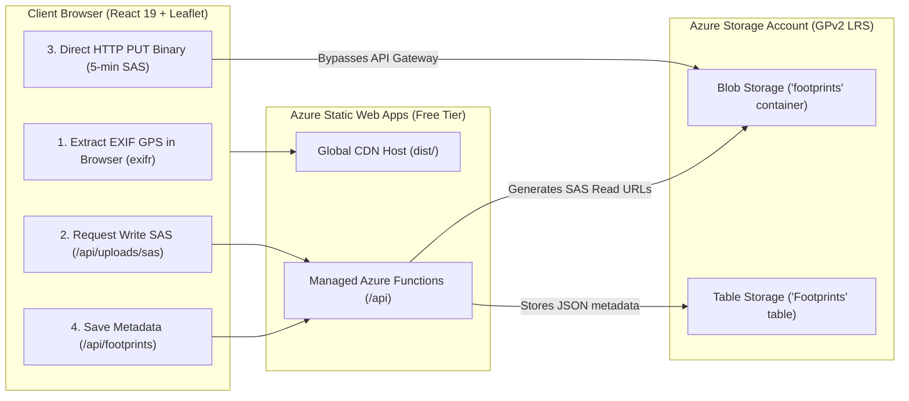

# FootprintPix 👣📸

> Retrace your personal journeys on an interactive, high-contrast world map with zero-bloat serverless architecture.

FootprintPix is an interactive, privacy-conscious travel map web application. Users can upload travel snapshots, extract embedded GPS EXIF metadata client-side, and visualize their journey footprints across an interactive global map.

Built with a **hybrid architecture**:
- **Offline / Local-First**: Operates seamlessly out-of-the-box using browser IndexedDB storage without requiring cloud configuration.
- **Production Serverless**: Scales to Microsoft Azure (Azure Static Web Apps + Azure Functions + Azure Blob Storage + Azure Table Storage) at **near-zero monthly cost (`~$0.00–$0.05/month`)**.

---

## 📸 Architecture & Upload Flow



---

## ✨ Features

- **High-Contrast Footprint Pin Markers:** Custom SVG teardrop markers with sole/toes geometry, a 2.5px crisp white border, and multi-layer drop shadows for maximum visibility against satellite and terrain basemaps.
- **Adaptive Camera Reframing:** Smooth Leaflet `flyToBounds` camera transitions when adding or deleting pins, automatically reframing the remaining journey or resetting to a world overview.
- **Client-Side EXIF & GPS Extraction:** Fast, private metadata extraction using `exifr` supporting JPEG, PNG, WebP, AVIF, and iPhone HEIC/HEIF photos.
- **Manual Pinning Fallback:** Interactive map picker allows users to easily drop a pin for snapshots lacking camera GPS data.
- **Inspection Drawer:** Slide-out panel to view full-resolution photos, optical specs (focal length, aperture, ISO, camera model), coordinates with Google Maps links, and editable travel reflection notes.
- **Soft-Delete Architecture & Trash Recovery:**
  - Deleting a photo flags `isDeleted = true` with a timestamp rather than permanently destroying the photo.
  - **"Recently Deleted" Trash UI:** Modal dialog to browse deleted photos with options to **Restore** them back to the active map or **Permanently Delete** them.
  - **Nightly Cleanup Cron:** Serverless Azure Timer Function (`0 0 2 * * *`) automatically purges soft-deleted records older than 30 days.
- **Mobile Responsive Design:** Dynamic viewport sizing (`h-[100dvh]`), iOS/Android safe-area padding (`viewport-fit=cover`), and unified compact header layout.
- **Direct-to-Blob SAS Uploads:** High-resolution photos stream directly from the browser to Azure Blob Storage using short-lived (5-minute) write-only SAS tokens, bypassing server memory limits.
- **Zero Monolithic Bloat:** Vite manual chunk splitting (`vendor-react`, `vendor-leaflet`, `vendor-exifr`) with client-side base64 memory disposal after upload.

---

## 🛠️ Tech Stack

| Layer | Technologies |
| :--- | :--- |
| **Frontend** | React 19, TypeScript, Vite 6, Tailwind CSS, Lucide React |
| **Mapping Engine** | Leaflet 1.9, Esri World Topographic & OpenStreetMap tiles |
| **Metadata & EXIF** | `exifr` (client-side binary parser) |
| **Local Persistence** | `idb-keyval` (IndexedDB) |
| **Cloud Hosting** | Azure Static Web Apps (Free Tier) |
| **Serverless API** | Azure Functions v4 (Node.js 20, TypeScript) |
| **Image Storage** | Azure Blob Storage (Standard GPv2, Locally Redundant Storage) |
| **NoSQL Database** | Azure Table Storage (PartitionKey / RowKey key-value store) |
| **CI / CD** | GitHub Actions (Decoupled automated CI + manual dispatch CD) |

---

## 💻 Local Setup & Development

You can run FootprintPix locally in two ways:

### Option A: Standalone Offline Mode (Fastest — No Azure Required)
In this mode, all snapshots and coordinates are saved to your browser's IndexedDB.

1. **Clone the repository:**
   ```bash
   git clone https://github.com/goutham2222/footprintpix.git
   cd footprintpix
   ```

2. **Install frontend dependencies:**
   ```bash
   npm install
   ```

3. **Start local Vite development server:**
   ```bash
   npm run dev
   ```

4. Open [http://localhost:5173](http://localhost:5173) in your browser.

---

### Option B: Full-Stack Local Mode with Azure Functions & Azurite
To test the Azure Functions API, direct Blob uploads, and Table Storage locally:

1. **Prerequisites:**
   - [Azure Functions Core Tools v4](https://learn.microsoft.com/en-us/azure/azure-functions/functions-run-local):
     ```bash
     npm install -g azure-functions-core-tools@4 --unsafe-perm true
     ```
   - [Azurite Storage Emulator](https://learn.microsoft.com/en-us/azure/storage/common/storage-use-azurite):
     ```bash
     npm install -g azurite
     # Or run with Docker:
     docker run -p 10000:10000 -p 10002:10002 mcr.microsoft.com/azure-storage/azurite
     ```

2. **Configure API Settings:**
   In `api/local.settings.json`:
   ```json
   {
     "IsEncrypted": false,
     "Values": {
       "FUNCTIONS_WORKER_RUNTIME": "node",
       "AzureWebJobsStorage": "UseDevelopmentStorage=true",
       "AZURE_STORAGE_CONNECTION_STRING": "UseDevelopmentStorage=true"
     },
     "Host": {
       "CORS": "*"
     }
   }
   ```
   *(Note: You can also substitute a real Azure Storage connection string in `AZURE_STORAGE_CONNECTION_STRING` for testing against cloud storage).*

3. **Install & Build the Backend API:**
   ```bash
   cd api
   npm install
   npm run build
   cd ..
   ```

4. **Run using Azure Static Web Apps CLI (Recommended):**
   ```bash
   npm install -g @azure/static-web-apps-cli
   swa start http://localhost:5173 --api-location api --run "npm run dev"
   ```

---

## ☁️ Azure Cloud Setup & Deployment

FootprintPix is engineered to deploy cleanly to Azure Static Web Apps and Azure Storage within Azure's Free/Student grants.

### Step 1: Provision Azure Resources via Azure CLI

All resources reside in a single Resource Group (`rg-footprintpix-prod`) for unified cost tracking and simple teardown.

```bash
# 1. Log in to Azure
az login

# 2. Create a Resource Group (e.g., East US 2)
az group create --name rg-footprintpix-prod --location eastus2

# 3. Create General Purpose v2 Storage Account (LRS)
az storage account create \
  --name stfootprintpixprod \
  --resource-group rg-footprintpix-prod \
  --location eastus2 \
  --sku Standard_LRS \
  --kind StorageV2 \
  --min-tls-version TLS1_2 \
  --allow-blob-public-access false

# 4. Create Blob Container ('footprints') and Table ('Footprints')
az storage container create --account-name stfootprintpixprod --name footprints --auth-mode login
az storage table create --account-name stfootprintpixprod --name Footprints --auth-mode login

# 5. Enable CORS on Blob Storage for Direct Browser PUT Uploads
az storage cors add \
  --account-name stfootprintpixprod \
  --services b \
  --methods GET PUT HEAD OPTIONS \
  --origins "http://localhost:5173" "https://*.azurestaticapps.net" \
  --allowed-headers "x-ms-blob-type,x-ms-version,content-type,content-length" \
  --exposed-headers "x-ms-request-id,ETag" \
  --max-age 3600

# 6. Retrieve your Storage Account Connection String
az storage account show-connection-string \
  --name stfootprintpixprod \
  --resource-group rg-footprintpix-prod \
  --query connectionString -o tsv
```

---

### Step 2: Create Azure Static Web App

```bash
# Create Static Web App (Free SKU)
az staticwebapp create \
  --name swa-footprintpix-prod \
  --resource-group rg-footprintpix-prod \
  --location eastus2 \
  --sku Free

# Set Storage Connection String in SWA Application Settings
az staticwebapp appsettings set \
  --name swa-footprintpix-prod \
  --setting-names AZURE_STORAGE_CONNECTION_STRING="<PASTE_CONNECTION_STRING_HERE>"

# Retrieve SWA Deployment Token for GitHub Actions
az staticwebapp secrets list \
  --name swa-footprintpix-prod \
  --query properties.apiKey -o tsv
```

---

### Step 3: Configure GitHub Actions & Deploy

1. In your GitHub repository, navigate to **Settings** &rarr; **Secrets and variables** &rarr; **Actions**.
2. Add a new repository secret:
   - **Name:** `AZURE_STATIC_WEB_APPS_API_TOKEN`
   - **Value:** The deployment token obtained in Step 2.

#### Deployment Architecture:
- **Continuous Integration (`.github/workflows/ci.yml`):** Automatically runs on pushes and pull requests to `main` (type-checking, linting, build verification).
- **Manual Continuous Deployment (`.github/workflows/azure-static-web-apps.yml`):**
  1. Go to **Actions** &rarr; **Manual CD - Deploy to Azure Static Web Apps**.
  2. Click **Run workflow** on the `main` branch.
  3. The action builds the Vite frontend (`/`), packages the API functions (`/api`), and deploys them to Azure Static Web Apps.

---

## 🛑 Teardown & Cost Management ($0 Running Guarantee)

FootprintPix runs on serverless services with no fixed hourly VM costs:
- **Azure Static Web Apps (Free Tier)** is **$0.00 / month forever**.
- **Azure Storage** only bills pennies for stored gigabytes (`~$0.018/GB/month`) and zero when empty.

If you ever want to completely delete all cloud resources from your Azure account to guarantee **zero ongoing cost or clutter**, use the built-in terminal teardown script:

### Local Terminal Teardown

Make sure you are logged in to the Azure CLI (`az login`), then run:

```bash
# 1. Preview the resources that will be removed (Dry Run)
npm run teardown:azure:dry-run

# 2. Interactively delete the Resource Group and all resources
npm run teardown:azure
```

To run with non-interactive confirmation or specify a custom Resource Group:
```bash
./scripts/azure-teardown.sh rg-footprintpix-prod --yes
```

This triggers `az group delete --name rg-footprintpix-prod --yes --no-wait` under your personal Azure CLI login, instantly stopping all billable storage and removing the Static Web App, Storage Account, Blob containers, and Table Storage.

---

## 📄 Scripts Reference

| Command | Description |
| :--- | :--- |
| `npm run dev` | Starts local Vite development server |
| `npm run type-check` | Runs TypeScript compiler checks without emitting code |
| `npm run build` | Compiles TypeScript and builds production distribution (`dist/`) |
| `npm run preview` | Serves the production build locally |
| `npm run teardown:azure` | Runs interactive Azure teardown script |
| `npm run teardown:azure:dry-run` | Previews Azure resources to be deleted without modifying anything |

---

## 📜 License

MIT License. Feel free to use and adapt FootprintPix for your personal travels!
